<p align="center">
  
</p>

<p align="center">
  <a href="https://www.anypayx.com"></a>
  <a href="https://www.anypayx.com/docs"></a>
  <a href="https://api.anypayx.com/api"></a>
  <a href="https://github.com/anypay"></a>
</p>

<p align="center">
  <a href="https://www.anypayx.com">Website</a> ·
  <a href="https://www.anypayx.com/docs">Docs</a> ·
  <a href="https://api.anypayx.com/api">API</a> ·
  <a href="https://www.anypayx.com/walletbot">WalletBot</a> ·
  <a href="https://www.anypayx.com/woocommerce">WooCommerce</a> ·
  <a href="https://checkout.anypayx.com">Checkout</a> ·
  <a href="https://github.com/anypay">GitHub</a> ·
  <a href="https://x.com/xanypay">@xanypay</a>
</p>

---

## What Anypay Is &amp; Purpose

**Anypay** is the complete payment infrastructure for businesses that want to accept Bitcoin, Ethereum, and stablecoins (USDC, USDT, RLUSD, NUSD) with zero volatility risk. We eliminate the complexity of multi-chain cryptocurrency payments through a unified API, SDKs, merchant tools, and automatic settlement to your preferred stablecoin.

Merchants use Anypay for invoicing, point-of-sale checkout, WooCommerce integration, and mobile payments. Developers use our TypeScript and Rust SDKs to embed crypto payment acceptance into any application. Every payment settles instantly to stablecoins on the blockchain of your choice — Bitcoin, Ethereum, XRP Ledger, Solana, Polygon, Avalanche, Binance Smart Chain, and more.

This is the official Anypay GitHub organization, where we build and maintain the entire payment stack — from invoice APIs and checkout UIs to self-custody wallets, price feeds, mobile apps, and blockchain settlement workers. All core infrastructure is open source.

## Why Use Anypay

Anypay solves three critical problems for businesses accepting crypto:

- **Eliminate volatility risk.** Every payment converts and settles to USDC, USDT, or other stablecoins instantly, so you never hold volatile Bitcoin or Ethereum.
- **Multi-chain simplicity.** One API, one invoice format, automatic chain selection. Your customer pays with Bitcoin; you receive USDC on Ethereum — all handled transparently.
- **Self-custody option.** Use our hosted platform or run WalletBot for fully self-custodied payments. You control the private keys; we provide the infrastructure.

**Who it's for:**

- **E-commerce merchants** who want to add "Pay with Crypto" to their checkout without handling blockchain complexity.
- **SaaS platforms** that need recurring stablecoin billing, invoicing APIs, and webhook integrations.
- **Physical retailers** who want point-of-sale crypto payments via iOS or Android merchant apps.
- **Developers** building payment-enabled applications who need simple SDKs and reliable price feeds.

**Where Anypay fits in the ecosystem:**

- Invoice &amp; payments layer above raw blockchain protocols.
- Multi-chain settlement aggregator with real-time price conversion.
- Stablecoin-first business logic, so merchants avoid price volatility.
- Self-custody option via WalletBot for businesses that want full control.

## How It Works

<p align="center">
  
</p>

The Anypay payment flow has four stages:

1. **Merchant POS &amp; Web Checkout** — Merchants create invoices via API, mobile app, WooCommerce plugin, or the web checkout UI. Each invoice supports multiple cryptocurrencies and chains.

2. **Core API &amp; Prices** — The Anypay invoice service calculates real-time exchange rates from live price feeds (Binance, Coinbase, Kraken, et al), generates payment addresses for the selected chain, and monitors the mempool for incoming transactions.

3. **Multi-Chain Settlement** — Once the customer's payment confirms on-chain, Anypay's settlement workers verify the transaction, convert the amount to stablecoins if needed, and forward the funds to the merchant's preferred stablecoin address.

4. **SDKs &amp; WalletBot** — Developers integrate Anypay into applications via TypeScript or Rust SDKs. For self-custody, WalletBot acts as a headless wallet that listens to invoice webhooks and automatically signs and broadcasts payment transactions.

The entire flow — from invoice creation to stablecoin settlement — takes seconds for most chains and completes with zero-confirmation acceptance for trusted merchants.

## Quickstart / How to Use Anypay

### For Merchants

**Sign up for a merchant account:**

```bash
# Visit the signup page
open https://www.anypayx.com/auth/signup
```

After registration, you can:

- **Create invoices via dashboard** — Log in, click "New Invoice," choose your stablecoin settlement currency, and share the payment link.
- **Install WooCommerce plugin** — Download from [anypayx.com/woocommerce](https://www.anypayx.com/woocommerce) or search "Anypay" in the WordPress plugin directory.
- **Use mobile POS apps** — Download the Anypay merchant app for [iOS](https://www.anypayx.com/download/ios) or [Android](https://www.anypayx.com/download/android).

### For Developers

**Install the TypeScript SDK:**

```bash
npm install @anypay/client
```

**Create an invoice programmatically:**

```typescript
import { Client } from '@anypay/client';

const anypay = new Client({ apiKey: process.env.ANYPAY_API_KEY });

const invoice = await anypay.createInvoice({
  amount: 100.00,
  currency: 'USD',
  settlementCurrency: 'USDC',
  webhook_url: 'https://yourdomain.com/webhook/anypay'
});

console.log('Payment URL:', invoice.url);
```

**Listen for webhook confirmations:**

Anypay sends a POST webhook when a payment confirms. Verify the signature (see [docs](https://www.anypayx.com/docs)) and update your application state.

**Use WalletBot for self-custody payments:**

```bash
npm install -g @anypay/walletbot
walletbot init
walletbot start
```

WalletBot monitors incoming invoice webhooks and automatically pays them from your self-custodied wallet. Full setup guide: [anypayx.com/walletbot](https://www.anypayx.com/walletbot)

### Core Repositories to Explore

| Repository | Description |
| --- | --- |
| [anypay](https://github.com/anypay/anypay) | Core invoice &amp; payments platform (TypeScript, Next.js, Prisma) |
| [anypay-sdk](https://github.com/anypay/anypay-sdk) | Official TypeScript SDK for browser &amp; Node.js |
| [anypay-rust](https://github.com/anypay/anypay-rust) | Rust SDK and client library |
| [web3-checkout-vite](https://github.com/anypay/web3-checkout-vite) | Current checkout UI hosted at checkout.anypayx.com |
| [walletbot](https://github.com/anypay/walletbot) | Self-custody headless wallet for automated payments |
| [merchant-app](https://github.com/anypay/merchant-app) | iOS &amp; Android point-of-sale mobile apps |
| [anypay-woocommerce](https://github.com/anypay/anypay-woocommerce) | Official WooCommerce payment gateway plugin |
| [anypayx.com](https://github.com/anypay/anypayx.com) | Marketing site, merchant dashboard, developer docs |
| [prices-ts](https://github.com/anypay/prices-ts) | Real-time cryptocurrency price feed service (TypeScript) |
| [prices-rs](https://github.com/anypay/prices-rs) | Real-time cryptocurrency price feed service (Rust) |
| [anypay-cli](https://github.com/anypay/anypay-cli) | Command-line interface for invoice creation &amp; management |

## Next Moves for Anypay Growth

The Anypay organization is actively maintained and continuously improving. High-leverage next moves for the ecosystem:

1. **Consolidate legacy coin-specific workers.** Many repos under `legacy_wallets` and `legacy_api` categories were coin-specific payment workers from the early architecture (e.g., `dash.anypay.global`, `bsv.anypay.global`). These can now be archived or consolidated into the unified settlement layer in the core `anypay` platform.

2. **Publish stable v1.0 SDK releases.** Both `anypay-sdk` (TypeScript) and `anypay-rust` are under active development. Cutting official v1.0 releases with semver guarantees and comprehensive API docs will accelerate developer adoption.

3. **Expand stablecoin settlement chains.** USDC and USDT are supported on Ethereum, Polygon, Avalanche, and others. Adding Solana USDC, Base, Arbitrum, and Optimism settlement routes will improve speed and reduce gas costs.

4. **Improve WalletBot key management &amp; multi-signature support.** WalletBot currently supports single-key self-custody. Adding hardware wallet integration (Ledger, Trezor) and multi-sig quorum signing would make it production-ready for high-value merchants.

5. **Enhance real-time price feed redundancy.** The `prices-ts` and `prices-rs` services aggregate from multiple exchanges, but adding fallback sources (CoinGecko, CryptoCompare) and circuit-breaker logic will improve uptime during exchange outages.

6. **Document and promote the invoice webhook flow.** Many developers integrate Anypay but don't fully utilize webhook confirmations for instant settlement UX. Better webhook documentation, example integrations (Stripe-style), and a testing sandbox would reduce time-to-production.

7. **Modernize mobile merchant apps.** The `merchant-app` repository uses an older React Native + Expo stack. Migrating to the latest Expo SDK, adding biometric authentication, and publishing updated App Store / Play Store releases would improve merchant onboarding.

8. **Enable recurring billing &amp; subscriptions.** Anypay currently handles one-time invoices. Adding subscription logic (monthly USDC auto-debits, invoice regeneration, dunning) would unlock SaaS use cases.

9. **Improve CI/CD across all repositories.** Many repos lack automated tests, Dependabot, or security scanning. Rolling out GitHub Actions workflows for linting, testing, and npm/crates.io publishing would reduce manual release overhead.

10. **Clarify licensing and contribution guidelines.** Some repos have no LICENSE file; others have MIT or Apache-2.0. Standardizing on a permissive license (MIT) and adding CONTRIBUTING.md templates org-wide would encourage open-source contributions.

## Anypay Ecosystem &amp; License

Anypay is an **open-source** payment infrastructure project. The core platform, SDKs, and most tooling are released under permissive licenses (MIT, Apache-2.0) to encourage developer adoption and community contributions.

**Primary Open-Source Projects:**

| Project | License | Language | npm / crates.io |
| --- | --- | --- | --- |
| [anypay](https://github.com/anypay/anypay) | — | TypeScript | `@anypay/server` |
| [anypay-sdk](https://github.com/anypay/anypay-sdk) | — | TypeScript | `@anypay/client` |
| [anypay-rust](https://github.com/anypay/anypay-rust) | — | Rust | `anypay` |
| [walletbot](https://github.com/anypay/walletbot) | — | TypeScript | `@anypay/walletbot` |
| [web3-checkout-vite](https://github.com/anypay/web3-checkout-vite) | — | TypeScript | — |
| [merchant-app](https://github.com/anypay/merchant-app) | — | Dart / Flutter | — |
| [anypay-woocommerce](https://github.com/anypay/anypay-woocommerce) | GPL-3.0 | PHP | WordPress Plugin Directory |
| [anypay-cli](https://github.com/anypay/anypay-cli) | — | TypeScript | `@anypay/cli` |
| [prices-ts](https://github.com/anypay/prices-ts) | — | TypeScript | `@anypay/prices` |
| [prices-rs](https://github.com/anypay/prices-rs) | — | Rust | `anypay-prices` |

**Contributing:**

We welcome pull requests, bug reports, and feature requests across all repositories. For security disclosures, email **security@anypayx.com** (do not open public issues for vulnerabilities).

**Supported Blockchains:**

Anypay currently supports payment acceptance and settlement on **Bitcoin (BTC), Ethereum (ETH), XRP Ledger (XRP), Solana (SOL), Bitcoin Cash (BCH), Bitcoin SV (BSV), Dogecoin (DOGE), Litecoin (LTC), Dash (DASH), Stellar (XLM), Avalanche (AVAX), Polygon (MATIC), Binance Smart Chain (BNB),** and stablecoins **USDC, USDT, RLUSD, NUSD** on multiple chains.

**Get Support:**

- **Developer Docs:** [www.anypayx.com/docs](https://www.anypayx.com/docs)
- **API Reference:** [api.anypayx.com/api](https://api.anypayx.com/api)
- **X / Twitter:** [@xanypay](https://x.com/xanypay)
- **GitHub Issues:** Open an issue in the relevant repository for bug reports or feature requests.

---

<p align="center">
  <a href="https://www.anypayx.com">
    
  </a><br/>
  <sub><strong>Bitcoin &amp; Stablecoin Payments For Business</strong><br/>
  <a href="https://www.anypayx.com">www.anypayx.com</a> · <a href="https://x.com/xanypay">@xanypay</a> · <a href="https://github.com/anypay">GitHub</a></sub>
</p>
